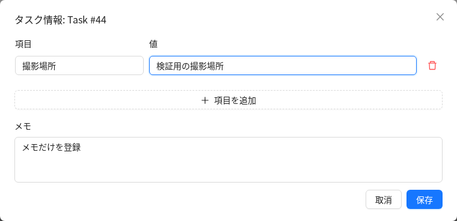

# タスク共通の背景情報

[共通運用](README.md) / [拡張機能の管理](management.md)

患者ID、検査条件、動画の撮影場所など、タスク内の画像やジョブに共通する情報を登録します。
任意の項目名と値、改行を含むメモを使用できます。項目に医療用途などの固定の分類はありません。

## 画面で確認する

タスク詳細のタスク名の横にある「タスク情報」から、登録内容を確認します。
画像・動画のアノテーション作業中は、既存の「Info」を開くとOverviewと統計の間に同じ情報を表示します。
ジョブごとのコピーは作らず、常に所属タスクの情報を読みます。
音声専用のInfo画面には今回の表示枠を追加していません。

編集できる利用者には、未登録なら追加、登録済みなら鉛筆のアイコンを表示します。
編集画面では項目を追加または削除し、値とメモを入力して保存します。メモだけの登録も可能です。
値はプレーンテキストとして表示し、改行を保持します。HTMLやMarkdownは実行しません。

保存に失敗した場合は入力を保持します。他の利用者が先に保存した場合は更新の競合を表示し、
古い版から上書きしません。再読み込みで入力を破棄するときは確認を表示します。
利用者、組織、タスクを切り替えると表示と編集中の情報を破棄し、以前の通信結果を表示しません。

### 表示例

以下は模擬APIと架空データを使った実コンポーネントの表示例です。




## 有効化と無効化

既存の設定ファイルの `CVAT_EXTENSIONS` に `task_context` を追加します。
使用中の他の拡張名は保持してください。画面プラグインの手動指定は不要です。

稼働中の構成を変更する場合は、旧構成で停止してから設定を編集します。

```sh
bash components/extensions/cvatctl down
# 既存の .env の CVAT_EXTENSIONS に task_context を追加する
bash components/extensions/cvatctl config
bash components/extensions/cvatctl doctor
bash components/extensions/cvatctl up
bash components/extensions/cvatctl check
```

サーバーとUIの再ビルドが必要です。既に同じソースと設定でビルドしたイメージがある場合に限り、
`up --no-build` で再利用できます。配備後はブラウザーを再読み込みします。
追加の常駐サービス、GPU、専用ボリュームは使用しません。

無効にする場合は、同じ手順で `task_context` を選択から外します。画面の入口とAPIを無効にし、
登録済みの情報はDBに保持します。再度有効にすれば表示できます。
データモデルとマイグレーションは常時登録するため、無効時もタスク削除に追従して情報を削除します。

## 閲覧と編集の権限

タスク詳細からの閲覧には標準のタスク閲覧権限、編集には標準のタスク説明の更新権限を使用します。
作業画面からの閲覧には標準のジョブ閲覧権限を使用するため、ジョブだけを割り当てられた利用者も
所属タスクの背景情報を確認できます。そのことによってタスクの編集権限が増えることはありません。

CVAT標準の認証、組織の判定、アクセストークンの制限を引き継ぎます。
項目単位のアクセス制限はありません。そのタスクの作業者に共有する情報を登録する用途です。
ブラウザーのローカルストレージには保存せず、API応答に `Cache-Control: no-store` を設定します。

## APIで登録する

APIの経路は以下のとおりです。IDは対象のタスクまたはジョブのIDです。

| 操作 | 経路 | 内容 |
| --- | --- | --- |
| GET | `/api/task-context/tasks/{id}/` | タスクの背景情報を取得します。 |
| GET | `/api/task-context/jobs/{id}/` | ジョブの所属タスクの背景情報を取得します。 |
| PUT | `/api/task-context/tasks/{id}/` | 取得した版番号を指定し、背景情報全体を置き換えます。 |

標準のCVAT認証と `Accept: application/vnd.cvat+json` を使用します。
組織の指定は標準の `org` または `org_id` に従います。
機能が無効な場合は404です。JSON専用APIのため、HTML表示とOPTIONSによるフォーム取得は提供しません。

取得結果の例です。以下は架空の情報です。

```json
{
  "task_id": 42,
  "fields": [
    { "name": "患者ID", "value": "P-DEMO-042" },
    { "name": "撮像施設", "value": "検証用施設" }
  ],
  "notes": "腹部超音波\n検証用データ",
  "version": 1,
  "can_edit": true
}
```

保存時には `fields`、`notes`、`version` の3項目だけを送ります。
未登録のタスクを取得したときの `version` は0です。保存が成功すると版番号が増えます。
古い版番号からの保存は409となり、内容は更新されません。空にする場合も空の配列と文字列を保存し、
版番号を0へ戻さないため、以前の画面からの保存を検出できます。

```json
{
  "fields": [{ "name": "撮影場所", "value": "検証用の撮影場所" }],
  "notes": "",
  "version": 0
}
```

項目は64件まで、項目名は128文字まで、値は4096文字まで、メモは16384文字までです。
文書全体はUTF-8のJSONで64 KiB以内です。項目名の前後の空白を除去し、空の名前と同じ名前の重複を拒否します。
値は文字列のみです。入れ子のJSON、ファイル添付、DICOMからの自動抽出、検索や絞り込みは今回の対象外です。

## 保存とバックアップ

情報は既存のPostgreSQLに追加する `task_context_taskcontext` 表へ保存します。
標準のTaskモデルやアノテーションのデータ構造は変更しません。

CVATのタスクバックアップには、登録済みの場合だけ `task_context.json` を追加します。
プロジェクトバックアップでは各タスクのディレクトリーに含め、復元時に新しいタスクへ引き継ぎます。
このファイルがない既存バックアップもそのまま読み込めます。
機能の有効化状態によらず保存と復元を行うため、無効時のバックアップでも情報は失われません。
更新時にはタスクと所属プロジェクトの更新日時を更新し、古いバックアップのキャッシュを再利用しないようにします。

通常のアノテーション形式やデータセットのエクスポートには含めません。
DB全体のバックアップでは、既存のPostgreSQLと同じ保存手順で保持します。

## 実装の配置と本体への接続

独自の保存処理、入力検証、権限の接続、API、バックアップ処理を `components/task_context/` に配置します。
表示と編集は `cvat-ui/plugins/task-context/` に配置します。

本体への変更は、Djangoアプリ登録、API経路、Dockerのコピー対象、バックアップへの接続と、
Info内の汎用プラグイン枠 `annotationPage.info.sections` の追加です。
タスク詳細は既存のプラグイン枠を使用します。Infoでは統計の読み込み中も背景情報を取得できます。

既存のAnnotationGuideはアノテーション手順書として維持します。
プロジェクト所属時にはプロジェクトのガイドを参照する既存動作があるため、タスク固有の情報の保存には流用しません。
DOMの探索や実行時の置き換えを避けるため、Infoへの小さな汎用の接続を追加しています。

## 検証

管理機能の回帰テストと、プラグインの通信および登録テストは次で実行できます。

```sh
python -m pytest -q components/extensions/tests/test_client_plugins.py \
  components/extensions/tests/test_cvatctl.py
node cvat-ui/plugins/task-context/tests/task-context.test.cjs
yarn tsc -p cvat-ui/tsconfig.json --noEmit
CLIENT_PLUGINS=plugins/task-context yarn run build:cvat-ui
```

バックエンドの独立テストは、Django、Django REST framework、attrs、requestsと、
Composeと同じ版のOPAを使用します。Pythonの版指定は `cvat/requirements/base.txt` に従います。

```sh
CVAT_TASK_CONTEXT_OPA=/path/to/opa python -m unittest discover \
  -s components/task_context/tests -p 'test_*.py' -v
```

入力検証、API、既存の認可ルール、読み取り専用トークン、CSRF、競合、無効時のデータ保持、
タスク削除への追従、バックアップの入出力を確認します。
テストでは軽量のタスクとジョブのモデルおよびSQLiteを使用します。
実際のCompose配備、PostgreSQLの同時実行、既存タスクを含む完全なバックアップ復元は、配備環境での確認が必要です。

実コンポーネントと模擬APIを使ったブラウザー操作でも、表示、保存、メモのみの登録、
保存失敗時の入力保持、競合時の再読み込み、閲覧専用表示、破棄確認、狭い画面、
セッション切り替え後の古い応答の破棄を確認しています。
