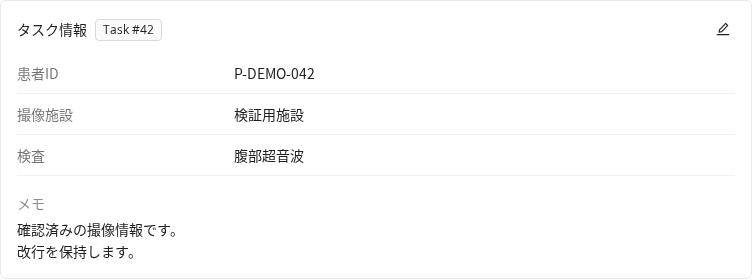

# タスクの説明や検査条件を表示する

[アノテーション操作](../annotation/README.md) / [拡張機能の管理](management.md)

作業説明、患者情報、検査条件、撮影場所などを、タスク詳細と画像や動画のInfoから確認する機能です。

説明の保存には、CVAT標準の説明文と添付ファイルを管理する機能 **AnnotationGuide** を使います。このページでは、タスクに付属する「AnnotationGuide」を「タスク用ガイド」と呼びます。編集、権限、バックアップもCVATの標準機能に従います。一括登録は[タスク説明の一括登録](task-guide-import.md)を参照してください。

## プロジェクト用とタスク用を使い分ける

プロジェクトと、その配下の各タスクは、それぞれ一つずつAnnotationGuideを保持できます。
標準UIではプロジェクト所属タスクの編集入口が隠れ、作業画面のGuideもプロジェクト用を参照します。
この拡張は、保存済みのタスク用ガイドへ別の入口を追加します。

| 情報 | 保存先 | 作業中の入口 |
| --- | --- | --- |
| ラベルの定義、共通の作業手順 | プロジェクト用AnnotationGuide | 既存のGuide |
| 患者情報、検査条件、撮影場所など | タスク用AnnotationGuide | Info内の「タスク情報」 |

既存のタスク用ガイドがある場合は、その内容をそのまま表示して編集します。
背景情報専用のガイドを追加で作るわけではありません。既存の手順書と併用する場合は、
同じMarkdown内で見出しを分けます。プロジェクト用ガイドの本文や、既存Guideの選択規則は変更しません。
プロジェクトに属さないタスクでは、既存のGuideもタスク用ガイドを表示し、
初回作業時などの標準の自動表示ルールが適用されます。

## 確認と編集

タスク詳細の「タスク情報」を押すと、タスク用ガイドを閲覧できます。
編集する場合は鉛筆、未登録なら追加のアイコンから、標準のガイド編集画面
`/tasks/{id}/guide` を開きます。Markdownを編集し、標準画面のSubmitで保存します。

画像や動画のアノテーション作業中は、InfoのOverviewと統計の間に同じ内容を表示します。
Info内は閲覧専用です。音声専用のInfoには表示枠を追加していません。

閲覧だけでは、空のガイドの作成や保存を行いません。標準エディターは、未登録の場合に
画面を開いた時点で空のガイドを作る既存動作があるため、閲覧と編集の入口を分けています。
ガイドを開き直すと最新情報を読み、利用者、組織、タスク、ジョブの変更後に古い通信結果を表示しません。

### 記載例

通常のMarkdownをそのまま使用します。独自のJSONや埋め込みメタデータは不要です。

```markdown
| 項目 | 内容 |
| --- | --- |
| 患者ID | P-DEMO-042 |
| 検査 | 腹部超音波 |
| 撮像施設 | 検証用施設 |

## メモ
評価用の架空データです。
```

表示は標準画面と同じMarkdownライブラリとサニタイズ処理を使用します。
項目と値に固定せず、見出し、表、箇条書き、標準ガイドの画像添付も利用できます。
独自の入力フォーム、自動抽出、項目による検索や絞り込みは提供しません。

### 表示例

以下は模擬APIと架空データを使った実コンポーネントの表示例です。



## 管理者向けの設定

既存の設定ファイルの `CVAT_EXTENSIONS` に `task_context` を追加します。他の拡張名は保持し、停止と再ビルドは[更新手順](update.md)に従ってください。

この機能を初めて配備するときは、サーバーとUIを同じ版へ更新します。サーバーには後述の読み取り専用の応答項目が必要です。導入後の有効化と無効化は、選択を変更してUIを再ビルドすると反映されます。追加の常駐サービス、GPU、専用ボリューム、機能専用の設定項目はありません。

無効にしてもガイドの内容は「AnnotationGuide」に保持され、標準の編集画面やAPIから引き続き扱えます。

## 権限と取得方法

閲覧には標準のタスク、ジョブ、ガイドのAPIを使用します。認証、組織、アクセストークンの制限、
ガイドの閲覧と編集の権限も標準の判定に従います。項目別のアクセス制限はありません。
編集リンクは標準エディターへの入口であり、編集権限を付与するものではありません。
同時編集や保存失敗時の動作も標準エディターに従います。

| 入口 | 取得順序 |
| --- | --- |
| タスク詳細 | `GET /api/tasks/{id}` の `guide_id` → `GET /api/guides/{guide_id}` |
| Info | `GET /api/jobs/{id}` の `task_guide_id` → `GET /api/guides/{task_guide_id}` |

ガイドがなければ二つ目の取得は行いません。取得したガイドが対象タスクのものであることも確認します。
タスクとジョブの取得は現在の組織を指定し、組織パラメーターを受けない標準ガイドAPIには指定しません。

ジョブの既存の `guide_id` は、プロジェクト所属時にプロジェクトのガイドを指します。
ジョブだけを割り当てられた利用者はタスク詳細APIを閲覧できないため、既存のJob応答に
読み取り専用の `task_guide_id` を追加しています。未登録時はnullです。
これによりタスク全体の閲覧権限を広げることなく、既に閲覧権限があるタスク用ガイドを取得できます。

## 保存とバックアップ

保存先は標準のAnnotationGuide、本文は標準のMarkdown、添付は標準のAssetです。
独自テーブル、独自の保存API、独自のバックアップファイルを追加しません。

標準のタスクバックアップはタスク用の `annotation_guide.md` と添付を保存します。
プロジェクトバックアップも、プロジェクト用ガイドと各タスク用ガイドをそれぞれ保存して復元する
既存処理をそのまま使用します。この拡張専用の移行処理はありません。
移行先のバージョンが対応する標準のガイド機能とバックアップ手順に従います。

通常のアノテーションやデータセットのエクスポートにガイドを独自追加する変更は行いません。

## 開発者向けの接続箇所

表示処理は `cvat-ui/plugins/task-context/` に置きます。本体への接続は次の二点です。

- Info内の汎用プラグイン枠 `annotationPage.info.sections`。統計の読み込み中も背景情報を取得できます。
- 既存のJob読み取りシリアライザーに、タスク用ガイドを指す `task_guide_id` を追加します。

タスク詳細では既存のプラグイン枠を使います。モデル、DBスキーマ、マイグレーション、
URL、権限規則、ガイドの保存処理、バックアップ処理は変更しません。

## 検証

```sh
python -m pytest -q components/extensions/tests/test_client_plugins.py \
  components/extensions/tests/test_cvatctl.py
node cvat-ui/plugins/task-context/tests/task-context.test.cjs
yarn tsc -p cvat-ui/tsconfig.json --noEmit
CLIENT_PLUGINS=plugins/task-context yarn run build:cvat-ui
```

標準のAPIテストには、プロジェクト用とタスク用ガイドの組み合わせ、未登録時のnull、
ジョブのみの担当者による取得、既存の `guide_id` の維持を確認する回帰テストを追加しています。
これらの統合テストにはCVATのAPIテスト環境が必要です。

ブラウザーでの受入確認では、ガイドの表示、標準エディターへの遷移、再表示時の再取得、未登録時の非作成、再試行、サニタイズ、狭い画面、組織とセッションの切り替えを確認します。模擬APIでの確認と、実際の配備でのAPI統合試験やバックアップ復元は区別して記録してください。
